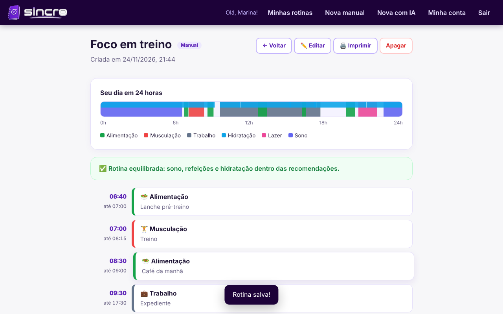
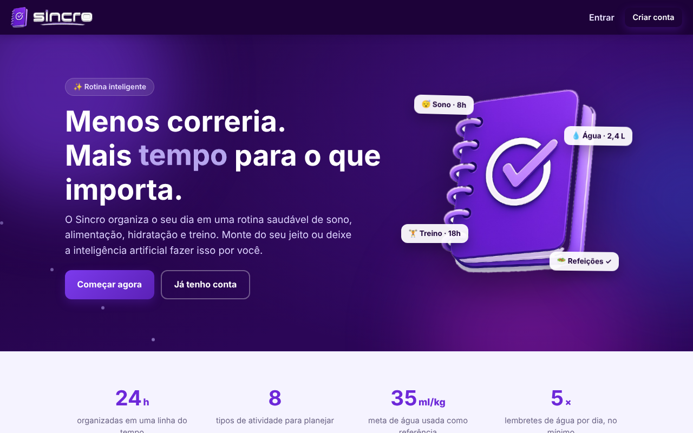
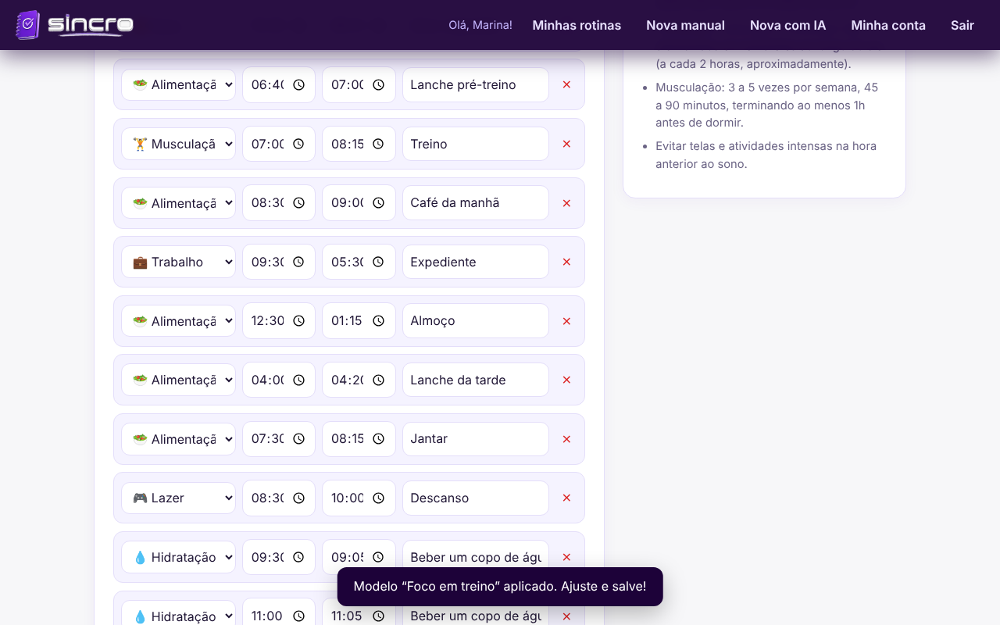
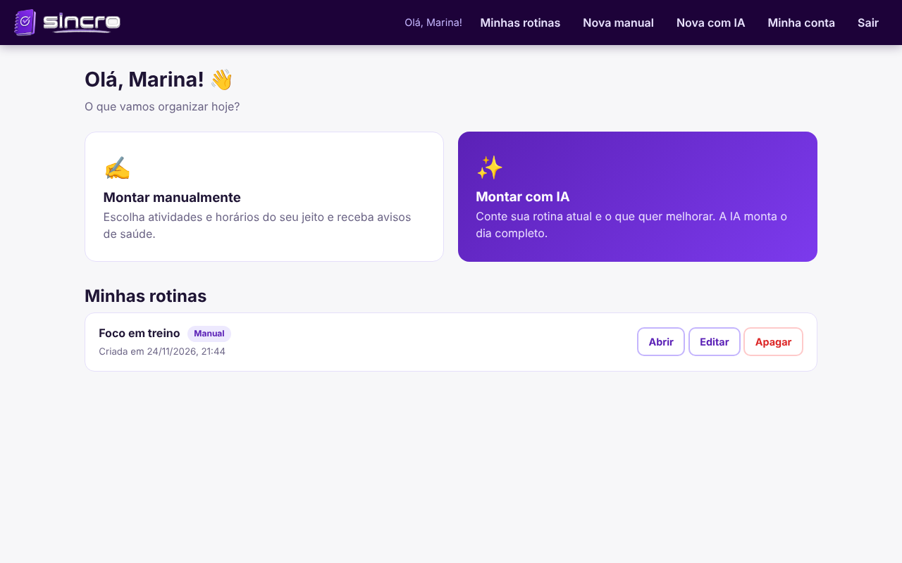

# Sincro

Organize seu dia, ganhe tempo.

O Sincro é um site que ajuda a montar uma rotina diária mais saudável. Eu parti de um problema simples: muita gente sente que o dia não rende e acaba cortando sono, refeição e água para caber tudo. A ideia aqui é você montar a sua rotina e o site avisar quando alguma coisa foge do recomendado.



## O que ele faz

Você cria uma conta e monta a rotina de duas formas. Na manual, escolhe as atividades e os horários, ou começa de um modelo pronto e ajusta. Na com IA, escreve como é o seu dia hoje e o que quer melhorar, e uma IA monta uma proposta.

Nos dois casos, o Sincro confere a rotina e mostra avisos. Ele olha as horas de sono para a sua idade, atividades no mesmo horário, intervalos muito longos sem comer, poucos lembretes de água e treino perto da hora de dormir. Se está tudo certo, aparece "Rotina equilibrada".

Dá para abrir, editar, imprimir e apagar as rotinas salvas. O site funciona no celular.

| Início | Modelos prontos | Painel |
|---|---|---|
|  |  |  |

## Como foi feito

O back-end é em Python com Flask, e o banco é SQLite, que fica num arquivo só e não precisa instalar nada. O front-end é HTML, CSS e JavaScript puro, servido pelo próprio Flask, então é tudo um projeto só.

O login usa senha com hash e token JWT. A pessoa só vê as próprias rotinas. Depois de 5 senhas erradas, o e-mail fica bloqueado por 5 minutos.

Como não tem envio de e-mail, a recuperação de senha funciona com um código. Ele aparece uma única vez no cadastro, e a pessoa usa esse código na tela "Esqueci minha senha". Quem perder a senha e o código não consegue recuperar a conta, e essa é uma limitação que eu conheço.

A IA é o Google Gemini, no plano gratuito. O site manda o perfil, a rotina atual e as regras de saúde, e pede a resposta em JSON. Antes de salvar, eu valido tudo: atividades permitidas, horários no formato certo e um mínimo de itens. Se a IA falhar por qualquer motivo (sem chave, sem internet, cota esgotada), o site monta a rotina por regras e avisa na tela que usou o modo automático. Assim ele não quebra por causa da IA.

As regras de saúde estão no arquivo `routine_rules.py`. O sono segue faixas por idade (por exemplo, 7 a 9 horas para adultos) e a meta de água é de cerca de 35 ml por kg. São orientações gerais e não substituem um profissional de saúde.

## Como rodar

Precisa do Python 3.10 ou mais novo. No Windows:

```
git clone https://github.com/SEU_USUARIO/sincro.git
cd sincro
python -m venv venv
venv\Scripts\activate
pip install -r requirements.txt
copy .env.example .env
python app.py
```

Depois abra http://127.0.0.1:5000. Tem que ser por esse endereço, porque abrir o `index.html` direto não funciona (o site depende da API). No Linux ou Mac, troque `venv\Scripts\activate` por `source venv/bin/activate` e `copy` por `cp`.

### Ligando a IA

Crie uma chave gratuita em aistudio.google.com e cole no `.env`, na linha `GEMINI_API_KEY=`. Reinicie o servidor e, na tela "Nova com IA", use o link "Testar a conexão com a IA", que diz se está funcionando ou o que deu errado. Sem a chave o site funciona normal, só que a rotina "com IA" sai no modo automático.

O `.env` não deve ir para o GitHub. Ele já está no `.gitignore`.

## Testes

```
python test_api.py
```

São mais de 50 verificações num banco temporário: cadastro, login, bloqueio, recuperação de senha, rotinas, modelos, edição, limite de uso da IA e a integração com o Gemini. Nessa parte as respostas do Gemini são simuladas, então o teste roda sem internet e sem chave.

## Arquivos

```
app.py             rotas da API, login e validações
ai_service.py      conversa com o Gemini
routine_rules.py   regras de saúde, modelos prontos e modo automático
database.py        conexão com o SQLite
schema.sql         tabelas
wsgi.py, Procfile  para hospedar
test_api.py        testes
static/            o site (html, css, js, imagens)
docs/              documentação mais detalhada
```

A documentação completa (banco, rotas da API, segurança) está em [docs/DOCUMENTACAO.md](docs/DOCUMENTACAO.md), e o passo a passo de GitHub e hospedagem em [docs/GUIA-PASSO-A-PASSO.md](docs/GUIA-PASSO-A-PASSO.md).

## Privacidade e limitações

O texto que a pessoa escreve na tela da IA é enviado ao Google. No plano gratuito do Gemini, o Google pode usar esse conteúdo para melhorar seus produtos, por isso o site avisa para não colocar dados sensíveis.

O plano gratuito do Gemini tem limites de uso baixos. Para não gastar a cota, cada usuário pode gerar 10 rotinas com IA por hora.

O SQLite atende bem um site pequeno. Para muitos acessos ao mesmo tempo, o ideal seria trocar por PostgreSQL.
